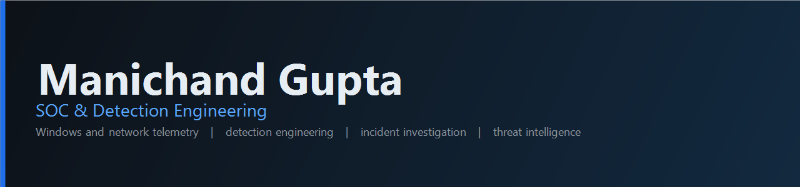

 

---

## Start here

If you only open two things, open these:

- **[SOC-Lab](https://github.com/EclipseManic/SOC-Lab)** — a 7-node hybrid-cloud SOC I built, then attacked for 74 minutes across 20 stages, and detected. The detection rules were written against the attack as it happened. → **[Live dashboard](https://soc-lab.eclipsemanic.me/)** · **[architecture diagram](https://github.com/EclipseManic/SOC-Lab/blob/main/06-Resources/diagrams/SOC_Lab_Architecture.png)**
- **[Investigation-Portfolio](https://github.com/EclipseManic/Investigation-Portfolio)** — seven investigations written as incident reports: the evidence, the reasoning, and what I could not conclude. → **[sample report](https://github.com/EclipseManic/Investigation-Portfolio/blob/main/Linux%20Server%20Investigation/report.md)**

## The work

*Repos are for investigations, labs and the workbench. Everything else I build is indexed in one [tools repository](https://github.com/EclipseManic/Security-Tools-and-Prototypes).*

- 🔬 **[SOC-Lab](https://github.com/EclipseManic/SOC-Lab)** — Wazuh, Sysmon, Suricata and pfSense across seven nodes, plus the detection rules written against the attack as it ran. → [Live dashboard](https://soc-lab.eclipsemanic.me/)
- 🕵️ **[Investigation-Portfolio](https://github.com/EclipseManic/Investigation-Portfolio)** — seven case reports built from PCAP, firewall, proxy and host artifacts: what the evidence supported, and where it ran out.
- 🧪 **[FTP-Service-Abuse-Detection-Lab](https://github.com/EclipseManic/FTP-Service-Abuse-Detection-Lab)** — a focused lab on detecting MSBuild inline-C# proxy execution hidden behind a Windows service.
- 🛠️ **SecLyst** — a local triage workbench putting IOC lookup, malware analysis, phishing analysis, EVTX event analysis and detection-rule translation in one place. *(in private development)*
- 🌐 **[Threat-Intelligence-OSINT-CaseStudies](https://github.com/EclipseManic/Threat-Intelligence-OSINT-CaseStudies)** — four evidence-led case studies assembled from open sources, with sourcing and confidence stated per claim.
- 🧰 **[Security-Tools-and-Prototypes](https://github.com/EclipseManic/Security-Tools-and-Prototypes)** — everything I build, indexed in one place: Windows service and SCM triage for DFIR (**ServiceSentinel**), an incident-response trainer with 133 scenarios (**SOC IR Trainer**), file-intelligence, firewall and log triage, and CLI analyzers — each with a committed sample of its real output.

## Tools I work with

`Wazuh` `Sysmon` `Suricata` `Wireshark` `Auditd` `TheHive` `Velociraptor` `MITRE ATT&CK` `Python` `PowerShell` `KQL` `Sigma` `Linux` `Windows`

## How I work

I use AI coding assistants for boilerplate, UI scaffolding and repetitive glue code — that is a large part of why tools like SecLyst exist at all. The lab design, the analysis, the findings and the judgement in every report are mine, and the write-ups say so.

I would rather state a limit than smooth it over. The reports describe scope, what the evidence did not support, and where a conclusion is only an inference. Nothing here is described as production-grade, because none of it is.

## Currently

Looking for SOC, detection engineering and threat-intelligence internships and entry-level roles in Delhi NCR, or anywhere that hires with relocation.